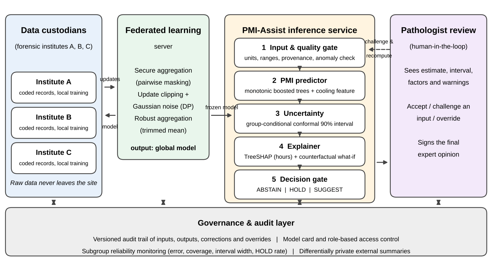
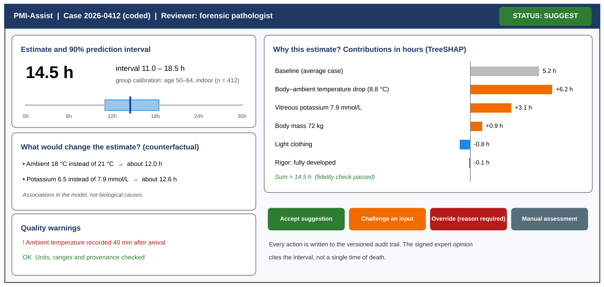

# PMI-Assist: Responsible AI Decision-Support for Post-Mortem Interval Estimation

A system design for an AI tool that helps forensic pathologists estimate the **post-mortem interval (PMI)**, the time since death. It gives a **calibrated uncertainty interval**, an **explanation the expert can challenge**, and a clear status that **abstains or holds** when the system should not be trusted.

The design addresses all three Responsible AI practices: **explainability, fairness and privacy preservation**.

> 📄 **Full design document:** [docs/PMI-Assist-System-Design.pdf](docs/PMI-Assist-System-Design.pdf)

---

## The problem

Classical PMI methods each rely on a single signal, such as body cooling (Henssge nomogram) or vitreous potassium. They often give wide or poorly calibrated estimates, and the reasoning that combines the signals is rarely documented in a way others can audit. Because a PMI estimate can end up in a police report or in court, an AI system here must be **accurate, honest about its uncertainty, equally reliable across groups, and protective of sensitive records**.

## System architecture

- **Federated training:** raw case records stay at each forensic institute. Only protected model updates are shared.
- **Five-stage inference pipeline:** input quality gate → PMI predictor → uncertainty → explainer → decision gate.
- **Human in the loop:** the AI suggests and the pathologist decides. They can accept, challenge an input or override with a reason.
- **Governance layer:** versioned audit trail, model card, subgroup monitoring and differentially private external reports.

## AI techniques used

| Stage | Technique | Purpose |
|---|---|---|
| Input checks | Rule-based validation + Isolation Forest | Catch unit errors and implausible inputs |
| Prediction | Linear regression, shallow decision tree, gradient-boosted trees with monotonic constraints and a physics-based cooling feature | Accurate, physiologically sensible estimates |
| Uncertainty | Split conformal prediction with group-conditional (Mondrian) calibration | 90% intervals with coverage checked per group |
| Explanation | TreeSHAP (in hours) + counterfactual what-if queries | Show why an estimate was made and what would change it |
| Training | Horizontal federated learning + secure aggregation + differential privacy | Learn across institutes without moving raw data |

## Responsible AI practices

### 🔍 Explainability
- Feature contributions shown **in hours**, for example "temperature difference adds +6.2 h"
- Counterfactuals, for example "if ambient temperature were 3 °C lower, the estimate would be about 2.5 h shorter"
- Explanations tailored to each audience: pathologists, courts and auditors (model card), and developers
- Evaluated for **fidelity, stability and usefulness** (DARPA XAI measures)

### ⚖️ Fairness
Fairness is defined as **equal reliability and equal access to help**, not identical predictions, with classic fairness definitions adapted to a regression task:

| Classic definition | Adapted metric | Proposed target |
|---|---|---|
| Equalised odds | Coverage parity across groups | Gap ≤ 5 percentage points |
| Equal error rates | Worst-to-best group MAE ratio | ≤ 1.25 |
| Demographic parity | Access parity (ABSTAIN / HOLD rates) | Gap ≤ 5 percentage points |

Mitigation happens at three stages: pre-processing (reweighting), in-processing (group-error monitoring) and post-processing (group-conditional conformal calibration).

### 🔒 Privacy preservation
- Threat model covering eavesdroppers, a semi-honest server, and poisoning or Sybil attackers
- Federated learning, **secure aggregation** (pairwise masking) and **DP-noised updates** with a tracked ε budget
- Robust aggregation (trimmed mean) and participant authentication
- External reports released with the **Laplace mechanism** under a cumulative privacy budget

The design also handles **trade-offs between the practices**, for example DP noise hurting small groups the most, and detailed explanations leaking training data.

## Evaluation plan
1. **Synthetic study:** about 6,000 cases split into training, validation, calibration and test sets (55/15/15/15)
2. **Retrospective multi-site data:** a held-out institute to test generalisation
3. **Practitioner study:** MAE, RMSE, interval coverage and width, HOLD/ABSTAIN rates, override rates and explanation metrics

## About this project
- **Course:** AI6101 Introduction to AI and AI Ethics, MSc Artificial Intelligence, Nanyang Technological University (2026)
- **Context:** a team mini-project (Team Ethicats). This repository contains **my individual design draft**, written before the team combined everyone's contributions into the final submitted report.
- **Author:** Veluchamy Punitha
- **Note:** this is a design document. Implementation was not part of the brief, and the scenario values shown are illustrative.

## Skills demonstrated
`Responsible AI` · `Explainable AI (SHAP, counterfactuals)` · `Algorithmic fairness` · `Federated learning` · `Differential privacy` · `Conformal prediction` · `ML system design` · `Value Sensitive Design`
